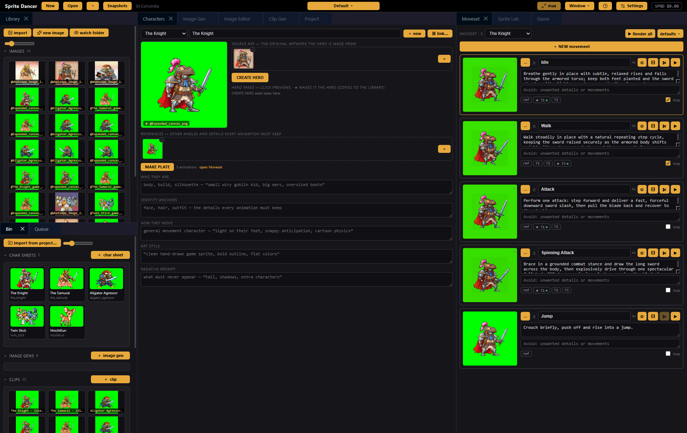
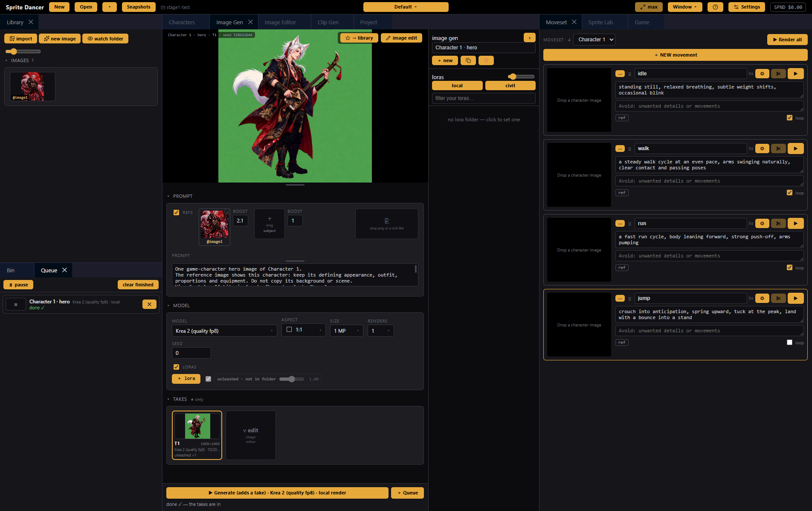
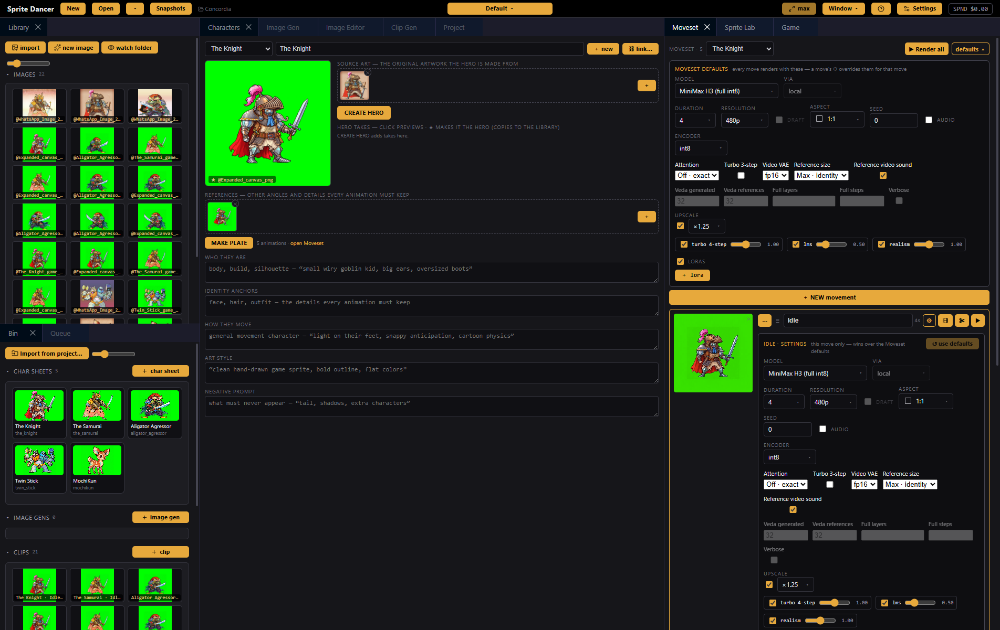
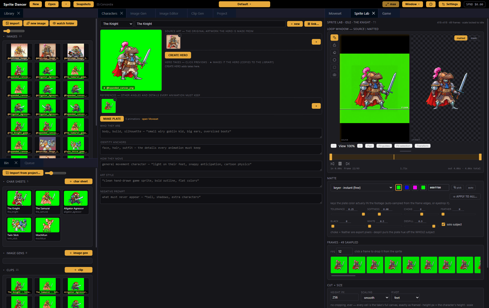
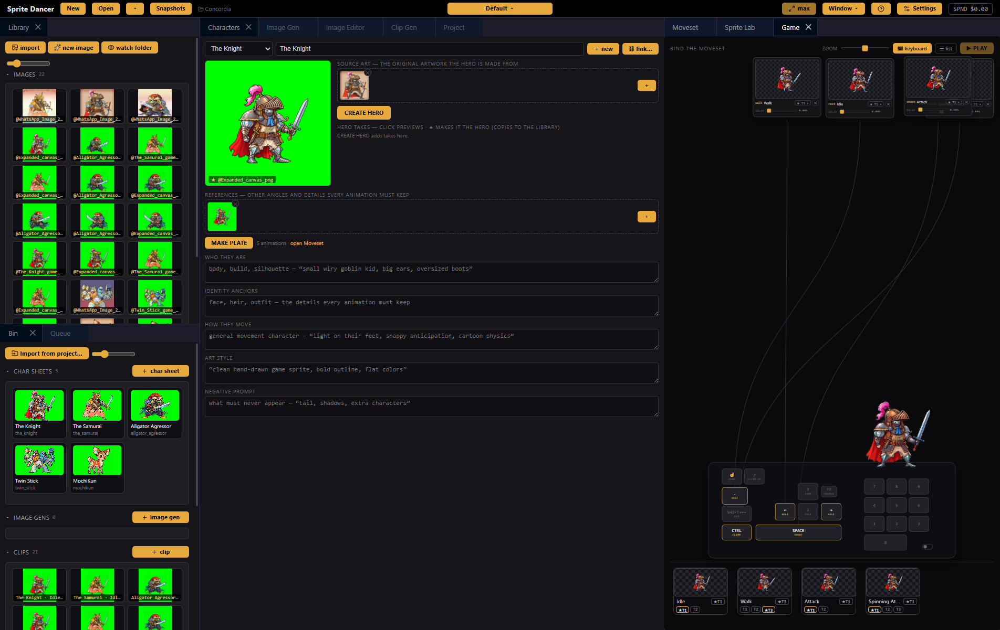

# Sprite Dancer

<b>Create, animate and finish sprites for games.</b> Free, for Windows.

  <a href="https://github.com/koan-shdw/sprite-dancer-source/releases/latest/download/SpriteDancer-Windows-Setup.exe">
    <picture>
      <source media="(prefers-color-scheme: dark)" srcset=".github/buttons/download-windows-dark.svg">
      
    </picture>
  </a>

<a href="https://www.shdw.work">shdw.work</a> · <a href="../../releases">every version</a> · <a href="EULA.md">licence</a>

One character image in, a full moveset of game-ready sprites out. You design a character, describe how they move, render each movement as a short video, then cut, key and size the frames into sprite sheets your engine can load. A playable test room shows the moveset working before you export a single file.

Sprite Dancer is built on [Video Dancer](https://github.com/koan-shdw/video-dancer). It uses Video Dancer's own Bin, Library, Image Gen, Image Editor, Clip Gen, Queue, Models and Settings, with the sprite tools on top. Every generator works the same way: making something creates its own item in the **Bin**, every render lands there as a **take**, and a take joins the **Library** only when you ★ it.

Local-first. Your files, your disk, your GPU. And every way to render, side by side in one dropdown:

- **LTX 2.5 and MiniMax H3 locally**, free on your own NVIDIA GPU, with LoRAs, attention, VAE and upscale settings.
- **Krea 2 locally** for character art: your original artwork in, game art out on the keying colour.
- **Seedance 2 and 2.5** through your **Bridge logins** (Higgsfield, Runway, Magnific, Pika: sign into the account, renders spend its subscription credits) or your own API keys.

**Free.** Download it from the button above.

---

## Characters

A character is an item in the Bin. Its card holds everything every animation must keep.

- **Source art**: drop the original artwork the hero is made from (Library images, or files straight from your desktop).
- **CREATE HERO**: renders the character's game art in Image Gen, on your own GPU. The same character as the source art, in the project's style, view and facing, full body on the keying background. The hero Image Gen is its own Bin item; every render lands there as a take.
- **★ a hero take**: it's copied to the Library and becomes the character's image.
- **References**: other angles and details every animation must keep.
- **MAKE PLATE**: a turnaround of the hero in Sheet Gen; the harvested sheet lands in the Library.
- **Who they are · identity anchors · how they move · art style · negative prompt**: the text every render reads.
- **⛓ link**: borrow another character's identity text (a cycle is refused).
- **The first character** arrives with four example moves: idle, walk, run and jump.

---

## Moveset

Every movement is a clip in the Bin. Its takes stack on the clip; the ★ keeper is the one the Lab and the Game use.

- **Describe the move** beat by beat, add what to avoid, and tick **loop** for a cycle.
- **▶** renders the move with the sprite prompt: the character as Image 1, the project's view and facing, a flat keying background, a locked camera, no cuts and no shadows. **▶ Render all** renders the whole moveset.
- **The first frame** is the character's hero; drag any Library image onto a move to start from that instead.
- **Take chips**: click to preview, double-click for the ★ keeper, right-click to colour, mark a dud, remove, open in Sprite Lab or read the prompt it was made with. Ctrl/Shift select several.
- **defaults ▾** (next to Render all): the generation settings every move renders with, in Clip Gen's own model section.
- **⚙ on a move**: the same settings for that move only. Anything set there wins over the defaults; ↺ hands a setting back, **use defaults** clears them all.
- **The film-strip button** opens the move in Clip Gen for its prompt, references and takes.
- **Drag the ≡ handle** to reorder.

---

## Sprite Lab

A take in, a finished sprite out.

- **Loop window**: trim the in and out points; the frames re-sample at your FPS. Click a frame to drop it.
- **Matte**: the instant keyer (auto-sampled plate colour, tolerance, softness, choke, feather, despill), or AI mattes on your GPU: **BiRefNet** for edge and hair detail, **BEN2** for stylised art, **RVM** for video. **Track** clicks the character with SAM 3 (needs a fal key). Mattes are cached per take, so nothing re-runs or re-bills.
- **Apply to all**: copy one matte setup across the moveset.
- **Guides, floor and stand height**: line up the character so every move sits at the same scale and on the same floor as idle.
- **Cut + size**: the character's height in pixels, smooth or pixel scaling, and the pivot.
- **Export**: frames, a sprite sheet, a GIF and the atlas JSON, per character and per move, into the project's exports folder or one you choose.

---

## Game

Bind the moveset to keys and play it in a test room.

- **Bind**: drag a move or a take onto a key (idle, walk, run, jump, double jump, duck, shoot, climb, hang, mantle and the number keys).
- **Tune**: delay, jump height, float and speed per binding.
- **Play**: platformer, arcade or adventure feel; the room uses your matted, sized sprites.
- **Title fonts**: ANSI title cards for the bind screen.

---

## Project

The game's direction, read by every character and movement prompt:

- **View / camera** and **facing**.
- **Era / visual style** (8-bit, 16-bit pixel art, cartoon, pre-rendered, claymation, real, hyper-real) and **character look** (normal or cute).
- **Keying background**: green, blue or magenta.
- **Keywords & art notes**.
- **Game feel**, **frame size** and **frames per second**.

---

## Built on Video Dancer

Everything else is Video Dancer's, unchanged:

- **Library**: the project's images, with folders, drag and drop, and the Image Editor on a double-click.
- **Bin**: characters, image gens and moves as tiles. Double-click opens each in its own panel.
- **Image Gen and Image Editor**: Krea 2 locally with refs, LoRAs and batches, plus edit-with-words on your logins.
- **Clip Gen**: the full model interface for any move.
- **Queue**: every render, with real progress, ✕ to stop and a pause.
- **Models**: download the local engines and models once; Sprite Dancer and Video Dancer share one model library.
- **Settings**: your keys and Bridge logins, stored only on your machine.
- **Workspaces**: Window ▾ opens any panel, and the layout dropdown saves arrangements.

---

## Your old Sprite Dancer projects

**Open ▾ → Import Sprite Dancer project…** and pick an old project folder. It's copied into a new project with its characters, heroes, references, image edits, every take, the Lab settings, mattes, game bindings and the old default render settings. The old folder is only read, never changed.

---

## New in 0.3.0

- Sprite Dancer is rebuilt on Video Dancer: its Bin, Library, Image Gen, Image Editor, Clip Gen, Queue, Models and Settings, with the Sprite screens on top.
- Characters: a character is a Bin item. CREATE HERO renders its game art in Image Gen on your own GPU, every render lands as a take, and ★ makes one the hero (a copy goes to the Library).
- Moveset: every movement is a clip in the Bin. ▶ renders it with the original sprite prompt, the takes stack on the clip and the keeper is ★.
- Moveset defaults ▾ and each move's ⚙ use Clip Gen's own model settings: LTX 2.5 and MiniMax H3 locally (attention, VAE, Veda, upscale, LoRAs) or Seedance on your logins.
- Sprite Lab, the Game and sprite-sheet export work as before: keyer, BiRefNet, BEN2 and RVM mattes, cut and size, frames, sheets, GIFs and the atlas.
- Import your projects from the old Sprite Dancer: Open ▾ → Import Sprite Dancer project… copies them across with their takes, lab settings, mattes and game bindings.
- Updates arrive on their own from Sprite Dancer's releases.

---

## Coming soon

- A macOS build.
- Signed installers.

---

## Install

Download it from the button at the top. Every version is on the [releases page](../../releases).

| Platform | File |
|---|---|
| Windows | SpriteDancer-Windows-Setup.exe |

The installer isn't signed yet. It's safe: when SmartScreen pops up, click "More info", then "Run anyway". After the first install it updates itself silently in the background.

The local engines need an NVIDIA GPU. Open **Models** to download the engine and a model the first time (Krea 2 for character art, LTX 2.5 or MiniMax H3 for moves). For Seedance, sign into a Bridge login or add a key in **Settings**. Your keys and files stay on your machine.

**Hit a bug?** Click the Sprite Dancer logo for **About**, then **open the log folder**, and attach `main.log` to a [new issue](../../issues/new).

---

## Licence

Free to use under the [Sprite Dancer licence](EULA.md). Video export runs a bundled [FFmpeg](https://ffmpeg.org) build (GPL) as its own program, delivered by [`ffmpeg-static`](https://github.com/eugeneware/ffmpeg-static); the in-app About box has its licence and attribution.
